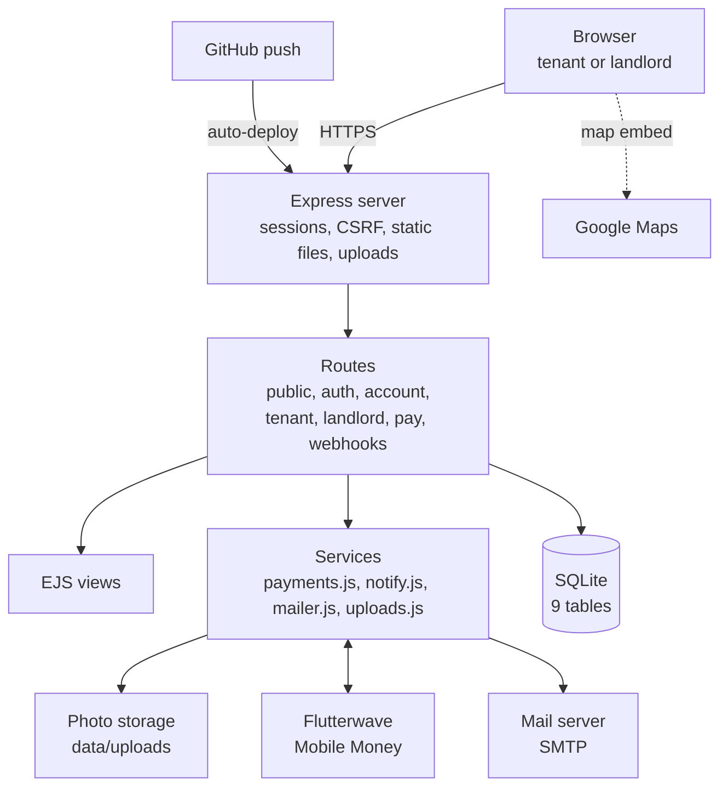
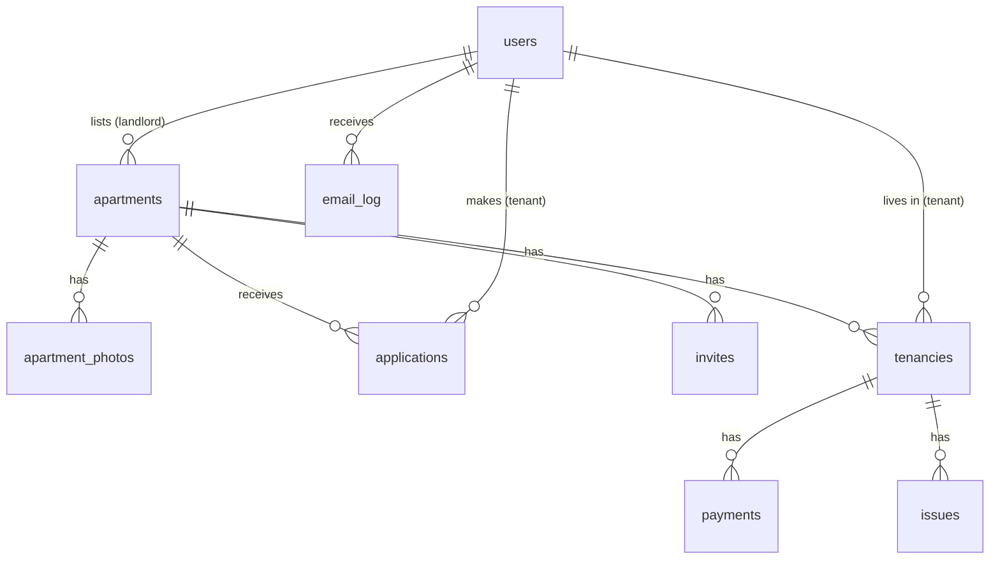

# Architecture

Tour Masters Apartments is one Node.js application. Express renders every page on the server with EJS templates, stores data in a single SQLite file, and calls out to Flutterwave for Mobile Money and to a mail server for alerts. There is no separate front-end build; the few interactive parts (slideshows, theme toggle, directions, startup animation) are small inline scripts.

## Stack

| Layer | Technology |
| --- | --- |
| Runtime | Node.js 22.5 or newer (the live site runs Node 24) |
| Web framework | Express 4, express-session |
| Pages | EJS templates, one stylesheet (`public/style.css`) |
| Database | SQLite through the built-in `node:sqlite` module |
| Uploads | multer (images only, 8 MB each, 12 per upload, 30 per apartment) |
| Email | nodemailer (SMTP, or HTML files in `data/outbox/`) |
| Passwords | bcryptjs, 10 rounds |
| Payments | Flutterwave API, or the built-in simulator |

## Request flow

Every request goes through the same steps in `src/server.js`:

1. Static files: `/static` (from `public/`) and `/uploads` (landlord photos).
2. `/webhooks` is mounted before the form parser, because Flutterwave sends JSON.
3. Form parsing and the session (HTTP-only, same-site cookie, 8 hours).
4. Load the logged-in user, the flash message, the CSRF token and view helpers into `res.locals`.
5. Reject any POST whose `_csrf` token does not match the session's.
6. Hand over to the route for that area; role checks (`requireRole`) guard the tenant and landlord areas.
7. 404 page, then an error page for anything thrown.

## Routes

| Area | Method and path | What it does |
| --- | --- | --- |
| Public | GET `/` | Landing page: slideshow, search, services, listings |
| | GET `/apartments/:id` | Apartment page: photos, services, map, contact, apply |
| | POST `/apartments/:id/apply` | Tenant applies |
| Auth | GET, POST `/login` · GET, POST `/register` · POST `/logout` | Accounts |
| Account | GET, POST `/account` | Contact details, alert and privacy settings, recent emails |
| Tenant | GET `/tenant` | My home, with tabs: overview, issues, payments, household, details |
| | POST `/tenant/join` | Connect with an invite code |
| | POST `/tenant/household` · `/tenant/profile` | Update household and details |
| | POST `/tenant/applications/:id/withdraw` | Withdraw an application |
| | POST `/tenant/issues` | Report a problem or suggestion |
| | POST `/tenant/pay` | Start a rent payment |
| Pay | GET `/pay/callback` · POST `/pay/recheck/:ref` | Return from Flutterwave, check a pending payment |
| | GET, POST `/pay/simulate/:ref` | The Mobile Money simulator |
| Landlord | GET `/landlord` | Dashboard: rent this month, unpaid tenants, issues, applications, homes |
| | GET `/landlord/tenants` · `/issues` · `/payments` | Lists |
| | GET `/landlord/apartments/new` · POST `/landlord/apartments` | Add an apartment |
| | GET, POST `/landlord/apartments/:id` | Manage and edit an apartment |
| | POST `/landlord/apartments/:id/invites` · `/landlord/invites/:id/delete` | Invite codes |
| | POST `/landlord/applications/:id/:decision` | Approve or decline |
| | POST `/landlord/issues/:id` | Reply and change status |
| | POST `/landlord/tenancies/:id/end` | End a tenancy |
| | POST `/landlord/apartments/:id/photos` · `/landlord/photos/:id/{caption,cover,move,delete}` | Photos |
| Webhooks | POST `/webhooks/flutterwave` | Payment results (checked against `FLW_SECRET_HASH`, then re-verified) |

## Data model

| Table | Holds |
| --- | --- |
| `users` | Tenants and landlords: contact details, WhatsApp, password hash, role, alert and contact preferences |
| `apartments` | Listing details, services, private address, status (available or occupied) |
| `apartment_photos` | Photo files, captions and order; the first is the cover |
| `applications` | Requests to rent, with household size, message and status |
| `invites` | One-time codes from a landlord to a tenant |
| `tenancies` | Who lives where, dates, household, status (active or ended) |
| `payments` | Rent per month: amount, network, phone, reference, status |
| `issues` | Problems and suggestions: category, urgency, status, landlord's reply |
| `email_log` | Every alert email and whether it was sent, saved, skipped or failed |

The schema lives in `src/db.js`. Columns added after the first release are added on start-up (`addColumn`), so existing databases keep their data. Foreign keys cascade, so deleting an apartment removes its photos, applications, tenancies, payments and issues.

## Source layout

| Path | Purpose |
| --- | --- |
| `src/server.js` | App setup, sessions, CSRF, mounting the routes |
| `src/db.js` | Schema and query helpers |
| `src/helpers.js` | Money and date formatting, maps, phone and WhatsApp links, role checks |
| `src/services.js` | The 22 apartment services and their icons |
| `src/payments.js` | Flutterwave client and the simulator |
| `src/uploads.js` | Photo upload rules |
| `src/mailer.js`, `src/notify.js` | Sending email, and the email for each event |
| `src/seed.js`, `src/demo-photos.js` | Demo data |
| `src/routes/` | One file per area (see Routes) |
| `views/` | Pages; `views/partials/` holds the header, footer, logo, slideshow and shared pieces |
| `public/` | Stylesheet, logo, demo photos |
