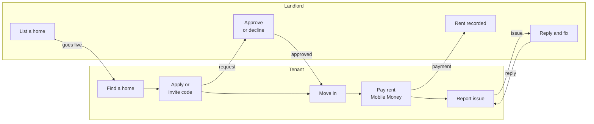

# Tour Masters Apartments: Project Report

Tour Masters Apartments is a web platform where tenants in Zambia find, rent and pay for homes, and landlords list, fill and manage them, all in one place.

| Item | Detail |
| --- | --- |
| Live site | https://tour-masters-apartments.onrender.com |
| Source | https://github.com/Adon-Chilembo/zambia-apartments |
| Users | Tenants and landlords |
| Coverage (demo data) | 33 homes from 10 landlords across 7 cities: Chingola, Chipata, Kabwe, Kitwe, Livingstone, Lusaka, Ndola |
| Rent payments | MTN MoMo, Airtel Money and Zamtel Kwacha through Flutterwave, with a built-in simulator |
| Built with | Node.js, Express, EJS templates, SQLite |
| Hosting | Render, redeployed automatically on every push to GitHub |

## Purpose and goals

Renting a home in Zambia usually runs through word of mouth, social media posts, agents and phone calls. Tenants cannot easily compare homes or see what services come with them. Rent is paid in cash or by Mobile Money with no shared record, and repair requests get lost in chats.

Objectives:

1. Let tenants find homes by city, bedrooms and rent, with real photos, listed services and the location.
2. Let tenants apply online, or join a home with an invite code from the landlord.
3. Take rent by Mobile Money and keep every payment on record.
4. Give tenants one place to report problems and follow the landlord's reply.
5. Give landlords one dashboard for their homes, applications, tenants, rent and issues.

## How it works

A tenancy starts when a landlord approves an application, or at once when a tenant enters the landlord's invite code. The apartment then shows as occupied, and rent and repairs flow between the two sides on the platform.

## Features for tenants

| Feature | What the tenant gets |
| --- | --- |
| Browse and search | Filter by city, bedrooms and maximum rent; each card shows a photo slideshow, rent, vacant or occupied, bedrooms and bathrooms |
| Apartment page | Photo gallery with full-screen viewer, services as icons (22 types), description and rent |
| Location and directions | A map of the neighbourhood and a button that draws the route from the tenant's current location |
| Contact the landlord | Call, WhatsApp with a ready-written message, or email, when the landlord allows it |
| Apply | Apply with household size and a message, or join with an invite code |
| Pay rent | Pay a chosen month by MTN, Airtel or Zamtel Mobile Money; a rent calendar and payment history |
| Problems and suggestions | Report by category and urgency, then follow the status and the landlord's reply |
| Household and details | Who lives in the home, occupation and an emergency contact |
| Email alerts | Optional emails for replies, rent and application decisions |

## Features for landlords

| Feature | What the landlord gets |
| --- | --- |
| Dashboard | Rent collected this month, unpaid tenants, open issues, waiting applications, every home |
| List a home | Title, area, private street address, rooms, rent, description and services; live at once |
| Photos | Up to 30 per home, with captions, ordering and a cover photo |
| Applications | Applicant's job, contact, household and message; approve or decline in one click |
| Invite codes | A code for a tenant already agreed offline |
| Tenants | Current tenants with household and contacts; end a tenancy when they move out |
| Rent | Every payment with tenant, month, network, reference, amount and status, plus the total received |
| Issues | Urgent first, filtered by status and type; reply and set Open, In progress or Resolved |
| Contact settings | Whether visitors see phone and WhatsApp on vacant listings |
| Email alerts | Optional emails for new applications, issues and payments |

## Design and branding

| Element | Choice |
| --- | --- |
| Logo | TM monogram with three blue buildings rising from the M (`public/logo.svg`) |
| Wordmark | "TOUR MASTERS" in Cinzel, with "APARTMENTS" in small spaced capitals |
| Colours | Prussian Blue #031130, SalesPort Blue #185DF1, Alice Blue #F3F7FE; amber and red only for status and errors |
| Body type | Inter |
| Themes | Light by default, dark mode toggle remembered per visitor |
| Landing page | See-through header over a slideshow of apartment photos with clickable names, and a floating search bar |
| Startup animation | Logo and wordmark animate in once per visit, about 2 seconds; skipped for reduced-motion users |

A 70-second portrait promo video (1080×1920) walks through the platform for tenants and landlords. It is kept outside the repository because of its size.

## Technology, data and security

The architecture, routes and data model are described in [architecture.md](architecture.md), and hosting in [deployment.md](deployment.md). In short:

- One Express application renders pages with EJS and stores data in SQLite (9 tables).
- Rent goes through Flutterwave; each result is confirmed on the return page and by webhook, and re-verified with Flutterwave before it counts.
- Passwords are hashed with bcrypt; sessions use HTTP-only, same-site cookies; every form carries a CSRF token.
- Street addresses are shown only to the landlord; uploads are images only, up to 8 MB, under random file names.
- Keys and passwords live in environment variables and are never committed.

## Testing, limitations and future work

**Testing.** Each feature was checked by hand in the browser with the seeded demo accounts (10 landlords, 20 tenants), at phone and desktop widths and in both themes. Payments were tested end to end with the simulator. There are no automated tests yet.

**Limitations.**

- On the free hosting plan, accounts, listings and photos are lost on every restart.
- Real payments need a live Flutterwave account; the live site uses the simulator.
- Emails are not sent until a mail server is configured.
- Visitors see the neighbourhood on the map, not the exact house; there is no map view of all listings.
- The demo accounts share one published password.

**Future work.**

1. A paid plan with a persistent disk, or cloud storage for photos and a hosted database.
2. Automated tests for sign-up, applications, payments and issues.
3. A live Flutterwave account, a mail service and the site's public address.
4. A map view of all listings, using coordinates landlords pick on a map.
5. SMS or WhatsApp alerts, PDF rent receipts and reminders before rent is due.
6. Password reset, login rate limiting and admin moderation of listings.
